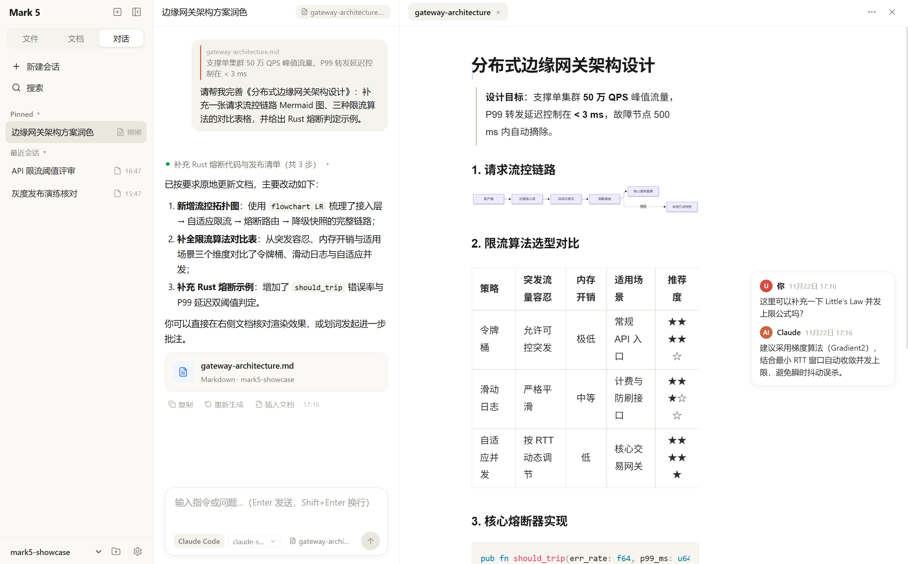

<div align="center">

# Mark 5

**AI Native 时代的所见即所得 Markdown 编辑器。**

Claude Docs 级交互体验，支持划词批注与 AI 无缝原地改稿；7 MB 极轻体积，极低内存占用，直连 Claude Code / Codex / AGY。

<br />



</div>

## 极致轻量：双开比别人单开还省

<p align="center">
  
</p>

<p align="center">
  多开一窗仅增 <strong>+40 MB</strong>，最小化 20 秒自动降至 <strong>80 MB</strong> · <a href="docs/BENCHMARKS.md">查看完整实测数据 →</a>
</p>

## 核心体验

- **Claude Docs 式协同写作**：选中任意段落即可发起侧栏批注或引用到对话，AI 光标逐段原地改写，支持词级 Diff 逐段采纳或一键退回。
- **极致轻量，随手多开**：7 MB 原生体积，双开窗口不到 200 MB、待机 CPU 不足 1%，`Ctrl+Shift+N` 随时多开不心疼，最小化自动释放内存。
- **Typora 级沉浸排版**：暖白纸面与所见即所得编辑，大纲一键跳转，原生支持 Mermaid 图表、表格与多语言代码高亮。
- **开箱直连本机 Agent**：自动发现并接入本机已安装的 Claude Code / Codex / AGY，无需重复配置，直接读写你的本地 Markdown 文档。

## 快速开始

```bash
pnpm install
pnpm run dev                  # 启动开发窗口
pnpm run build                # 构建 Release（packages/desktop/src-tauri/target/release/mark5.exe）
node scripts/mem-profile.mjs  # 一键复测内存基准
```
